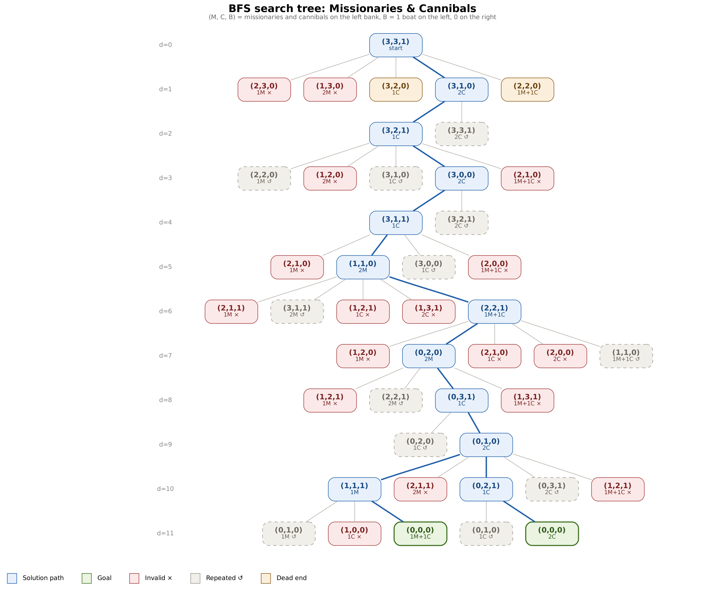

# Artificial Intelligence 2026/27: Assignment 1 (Uninformed Search)

Solutions for the [first semester assignment](https://github.com/adrianymeri/Artificial-Intelligence-2026/blob/main/Detyra1.md).

| # | Problem | Method | Code |
|---|---|---|---|
| 1 | Social Golfers | DFS + backtracking | [`social_golfers.py`](problemi1_social_golfers/social_golfers.py) |
| 2 | Sudoku | BFS + backtracking | [`sudoku.py`](problemi2_sudoku/sudoku.py) |
| 3 | Latin Square | IDDFS + backtracking | [`latin_square.py`](problemi3_latin_square/latin_square.py) |
| 4 | Search Trees | 8-Puzzle, M&C, RWS | [`search_trees.py`](problemi4_search_trees/search_trees.py) |

Python 3.10+, no external libraries. Only uninformed search is used (no heuristics, no MRV, no forward checking, no local search).

---

## Problem 1: Social Golfers (DFS + backtracking)

> 32 golfers play golf once a week, always in groups of 4. For how many weeks can they play so that no two golfers play in the same group more than once?

### Modelling

An instance is written **g-p-w**: g groups per week, p players per group, w weeks, n = g · p golfers. Ours is **8-4-w** (n = 32).

We model it as a **constructive search problem**: the schedule is filled one place ("slot") at a time, in the order *week → group → position in the group*.

| Component | Social Golfers |
|---|---|
| **State** | A partly filled schedule (the first k slots are filled) |
| **Action** | Put a golfer into the next free slot |
| **Start state** | The empty schedule |
| **Goal test** | All w · g · p slots are filled and no constraint is broken |
| **Cost** | Uniform (we only care whether a solution exists) |

The depth of the tree is w · g · p (e.g. 224 for 7 weeks), and every solution lies at this last depth.

### Representation

| | |
|---|---|
| **Variables** | x[j, g, v] = the golfer in week j, group g, position v. In total w · g · p variables (224 for 8-4-7) |
| **Domain** | {1, 2, …, 32} |
| **Solution** | `schedule[week][group]` = the 4 golfers of that group. Every week is a split of the 32 golfers into 8 groups |

Example, week 1:

```
{1 2 3 4} {5 6 7 8} {9 10 11 12} {13 14 15 16} {17 18 19 20} {21 22 23 24} {25 26 27 28} {29 30 31 32}
```

**Constraints** (both hard, there are no soft constraints):

| | Constraint |
|---|---|
| **H1** | Every golfer plays **exactly once** per week |
| **H2** | Every pair of golfers is in the same group **at most once** over all weeks |

**Formally**, with $x_{j,g,v} \in D = \{1, \dots, 32\}$ and $G_{j,g} = \{x_{j,g,v} : v = 1..4\}$ the players of group g in week j:

$$\text{H1:}\quad \forall j,\ \forall i \in D:\quad \big|\{(g, v) : x_{j,g,v} = i\}\big| = 1$$

$$\text{H2:}\quad \forall i \neq k \in D:\quad \big|\{(j, g) : i \in G_{j,g} \land k \in G_{j,g}\}\big| \le 1$$

**Search space.** The number of ways to split 32 golfers into 8 groups of 4 (one week) is:

$$P = \frac{32!}{(4!)^8 \cdot 8!} \approx 5.93 \times 10^{19}$$

(divide by (4!)⁸ because the order inside a group does not matter, and by 8! because the order of the groups does not matter). The representation changes the size a lot:

| Representation | Formula | w = 10 |
|---|---|---|
| Every slot any golfer | 32^(32w) | 10⁴⁸¹ |
| Every week a permutation | (32!)^w | 10³⁵⁴ |
| **Every week a partition** | P^w | 10¹⁹⁷ |

**Symmetry breaking.** The same schedule can be written in many ways (swap weeks, groups, golfers). To search each schedule only once:

1. Week 1 is fixed: {1..4}, {5..8}, …
2. Inside a group, golfers are in increasing order.
3. The first golfer of each group is the smallest golfer not yet placed that week.

This is not a heuristic: it only removes copies of the same solution.

### Objective function

**Objective:** maximise the number of weeks w.

**Upper bound:** every week a golfer meets 3 new golfers, and there are only 31 others, so:

$$w \cdot 3 \le 31 \quad\Rightarrow\quad w \le 10$$

**Evaluation function:**

$$\text{eval}(S) = \text{number of repeated meetings}$$

A pair that meets once adds 0, twice adds 1, three times adds 2, and so on. **eval = 0 ⇔ valid schedule.**

### Landscape (simple)

- **Neighbour:** swap two golfers from different groups of the same week.
- **Picture:** a random 10-week schedule has on average ~163 repeated meetings, while a solution has 0. Solutions are extremely rare, and many neighbours have the same eval (flat areas). So random search does not work; we need systematic search with pruning.

### Result

DFS finds **7 weeks in ~0.1 s** (62,268 nodes). 8 weeks were not found even after ~930 million nodes (12 runs with different seeds, ~27 minutes in total): near the bound 10, solutions are so rare that uninformed search does not reach them in reasonable time.

The search has **no time limit**. To stop it, press **Ctrl + C**: the program then prints what it found so far (with `--max`, the best number of weeks and its schedule).

```bash
python problemi1_social_golfers/social_golfers.py           # 32 golfers, 7 weeks
python problemi1_social_golfers/social_golfers.py 8 4 --max # try w = 1, 2, 3, ... (stop with Ctrl + C at w = 8)
```

---

## Problem 2: Sudoku (BFS + backtracking)

> Write a program that solves Sudoku puzzles at three levels: Easy, Medium and Hard.

### Modelling

Sudoku is a 9×9 grid divided into nine 3×3 boxes. Some cells are given, and the rest must be filled with 1–9 so that every row, column and box contains each digit exactly once.

| Component | Sudoku |
|---|---|
| **State** | The grid: given cells + cells filled so far |
| **Action** | Write a digit 1–9 into the **first empty cell** (reading order) |
| **Start state** | The puzzle |
| **Goal test** | No empty cell left (and all constraints hold) |
| **Cost** | Uniform |

Every action fills one cell, so if the puzzle has k empty cells, **every solution lies at depth k** (45–60 for our puzzles).

**Levels:**

| Level | Definition |
|---|---|
| **Easy** | Solved only by filling cells that have **one possible digit** |
| **Medium** | Also needs: a digit that has **only one possible place** in a row, column or box |
| **Hard** | These rules are not enough; you have to guess and go back |

### Representation

| | |
|---|---|
| **Variables** | The empty cells. Cell (row r, column c) has index 9r + c |
| **Domain** | {1, 2, …, 9} |
| **Peers** | Every cell has 20 cells that may not have the same digit: 8 in its row, 8 in its column, 4 more in its box |
| **State** | 81 values, 0 = empty |

**Constraints** (all hard):

| | Constraint |
|---|---|
| H1 | Each digit at most once in every row |
| H2 | Each digit at most once in every column |
| H3 | Each digit at most once in every 3×3 box |
| H4 | The given cells do not change |

**Formally**, with $x_{r,c} \in D = \{1, \dots, 9\}$ (r, c = 0..8), $B_{p,q} = \{(r, c) : 3p \le r \le 3p+2,\ 3q \le c \le 3q+2\}$ the 3×3 boxes, and $a_{r,c}$ the given digits:

$$\text{H1:}\quad \forall r,\ \forall c \neq c':\quad x_{r,c} \neq x_{r,c'}$$

$$\text{H2:}\quad \forall c,\ \forall r \neq r':\quad x_{r,c} \neq x_{r',c}$$

$$\text{H3:}\quad \forall p, q,\ \forall (r,c) \neq (r',c') \in B_{p,q}:\quad x_{r,c} \neq x_{r',c'}$$

$$\text{H4:}\quad \forall (r,c) \text{ given}:\quad x_{r,c} = a_{r,c}$$

**Search space** for the hardest puzzle (Inkala, 60 empty cells):

| Representation | Size |
|---|---|
| Every cell (also given ones) any digit: 9⁸¹ | 10⁷⁷ |
| Only the empty cells, each 1..9: 9⁶⁰ | 10⁵⁷ |
| Every row is a permutation of its missing digits | 10³⁰ |

### Objective function

**Objective:** find the complete grid that satisfies H1–H4.

**Evaluation function:**

$$\text{eval}(G) = \text{number of repeated digits in all rows, columns and boxes}$$

Example: a column with (5, 3, 5, 1, 9, 5, 2, 8, 7) has 9 cells and 7 different digits → 2 repetitions. **eval = 0 ⇔ solution.**

### Landscape (simple)

- **Neighbour:** swap two non-given cells in the same row.
- **Picture:** for a small 4×4 Sudoku, only 1 grid out of 72 is a solution. For 9×9 there is 1 solution among 10¹⁹–10³⁰ grids, and about a quarter of the neighbours have the same eval. The solution is a single "hole", so systematic search is needed.

### Result

**12/12 puzzles solved** (4 easy, 4 medium, 4 hard). Easy needs < 1,000 states, hard up to 2 million (Inkala, ~4 s). BFS keeps a whole level in memory (up to ~44 MB), so memory is its limit.

**Input check.** Before searching, the program checks that the givens do not already break a rule. An invalid puzzle is reported instead of being searched, e.g. `Invalid puzzle, not searched: column 3 has digit 3 2 times`. If the search finishes without a solution, it says so (`no solution exists`) instead of showing a half-filled grid.

```bash
python problemi2_sudoku/sudoku.py               # all puzzles
python problemi2_sudoku/sudoku.py --level hard
```

---

## Problem 3: Latin Square (IDDFS + backtracking)

> Given n, print an n × n matrix with the numbers 1..n so that each number appears exactly once in every row and every column.

### Modelling

The grid is filled one cell at a time, row by row.

| Component | Latin Square |
|---|---|
| **State** | A partly filled n × n grid |
| **Action** | Write a number 1..n into the **next empty cell** |
| **Start state** | First row = 1, 2, …, n and first column = 1, 2, …, n (reduced form) |
| **Goal test** | All cells filled, no repeats in any row or column |
| **Cost** | Uniform |

Every solution lies at the **same depth**: d = (n − 1)², which is 16 for n = 5.

### Representation

| | |
|---|---|
| **Variables** | x[r][c] = the cell in row r, column c. In total n² variables |
| **Domain** | {1, 2, …, n} |
| **State** | An n × n matrix, 0 = empty cell |

**Constraints** (both hard):

| | Constraint |
|---|---|
| H1 | Every row contains each number exactly once |
| H2 | Every column contains each number exactly once |

**Formally**, with $x_{r,c} \in D = \{1, \dots, n\}$:

$$\text{H1:}\quad \forall r,\ \forall c \neq c':\quad x_{r,c} \neq x_{r,c'}$$

$$\text{H2:}\quad \forall c,\ \forall r \neq r':\quad x_{r,c} \neq x_{r',c}$$

(With n cells in a row and n possible values, "all different" means every number appears exactly once.)

Unlike Sudoku, there are no boxes and no given cells, so a solution **always exists**.

**Search space:**

| Representation | Formula | n = 5 |
|---|---|---|
| Cell by cell | n^(n²) | 3 × 10¹⁷ |
| Row by row (each row a permutation) | (n!)ⁿ | 2.5 × 10¹⁰ |

**Reduced form.** Renaming the numbers or reordering the rows of a Latin square gives another Latin square. So we can fix the first row and the first column to 1, 2, …, n without losing any solution. Only (n − 1)² cells remain to search.

### Objective function

**Objective:** find an n × n grid that satisfies H1 and H2.

**Evaluation function:**

$$\text{eval}(G) = \text{number of repeated numbers in all rows and columns}$$

Example for n = 3:

```
1 2 3      rows:    no repeats                → 0
2 3 1      columns: (1,2,1) (2,3,2) (3,1,3)   → 1 + 1 + 1 = 3
1 2 3                                           eval = 3
```

**eval = 0 ⇔ Latin square.**

### Landscape (simple)

- **Neighbour:** swap two numbers in the same row.
- **Picture:** for n = 3 there are 216 grids (rows as permutations) and 12 are solutions. For n = 4, 576 of 331,776 grids are solutions (0.17 %). The share of solutions falls fast as n grows, and there are flat areas where no swap helps.

### Result

- **n = 5 with IDDFS:** solution at depth 16, 17 iterations, 4,907 nodes.
- **Backtracking:** solves even n = 30 in 0.2 s.
- IDDFS gives no advantage here: all solutions are at the bottom of the tree, so every iteration before the last one is wasted work.

**Correctness check (`--count`).** DFS can also count *all* reduced Latin squares; every reduced square gives n! · (n − 1)! Latin squares (rename the numbers, reorder rows 2..n). The counts match the known values:

| n | 3 | 4 | 5 | 6 |
|---|---|---|---|---|
| Reduced squares found | 1 | 4 | 56 | 9,408 |
| All Latin squares | 12 | 576 | 161,280 | 812,851,200 |
| Time | < 0.01 s | < 0.01 s | < 0.01 s | 0.13 s |

```bash
python problemi3_latin_square/latin_square.py 5
python problemi3_latin_square/latin_square.py 20 --method backtracking
python problemi3_latin_square/latin_square.py 5 --count     # count all Latin squares
```

---

## Problem 4: Search Trees

Each tree is built with BFS. The root is the start state, and each child is one action away. Repeated states are marked and not expanded (otherwise the tree is infinite), and invalid states cut the branch.

| | 8-Puzzle | Missionaries & Cannibals | RWS |
|---|---|---|---|
| State | 3×3 board | (M, C, B) on the left bank | partial schedule (3 employees × 7 days) |
| Actions | move the blank Up/Down/Left/Right | boat carries 1–2 people | assign D, N or – to the next cell |
| Tree | 27 nodes, 8 repeated | 49 nodes, 18 invalid, 15 repeated | day 1: 6 of 27 valid; day 2: 4 of 6 |
| Solution | depth 3: Right → Down → Right | depth 11 (2 solutions) | depth 21 (all cells) |
| Fitting algorithm | BFS / IDDFS | BFS | DFS + backtracking |

The trees are in [`problemi4_search_trees/pemet/`](problemi4_search_trees/pemet/):



```bash
python problemi4_search_trees/search_trees.py mc        # tree in the terminal
python problemi4_search_trees/search_trees.py mc --dot | dot -Tpng -o mc.png   # drawing (needs Graphviz)
```

**Conclusion.** When the solution can be shallow (8-Puzzle, M&C), BFS/IDDFS find the shortest one. When every solution is at maximum depth (Golfers, Sudoku, Latin Square, RWS), DFS with backtracking is the natural choice.
